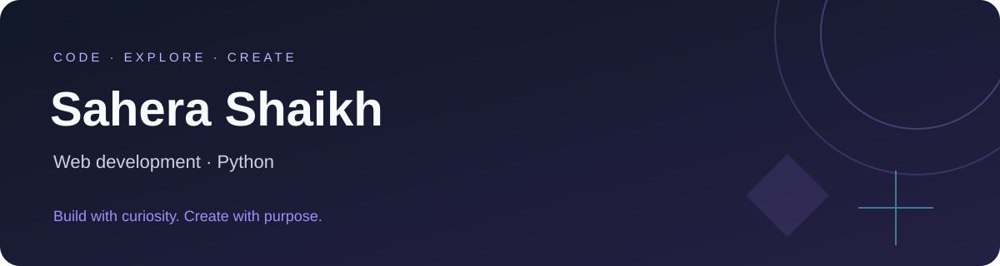

  <a href="https://github.com/SaheraShaikh?tab=repositories">Explore my projects</a> ·
  <a href="https://pasteapp-zeta.vercel.app">Try Pasteapp</a>

## Hi, I'm Sahera 👋

I'm a final-year Computer Engineering student who enjoys turning ideas into useful applications. I work with Python and Java, build responsive web experiences, and explore how AI can solve practical problems.

My projects span healthcare appointment systems, scientific collaboration analysis, computer vision, and everyday tools. I care about clear interfaces, thoughtful functionality, and learning through building.

## Featured projects

| Project | What I'm building | Technologies |
| :--- | :--- | :--- |
| **[Scientific Collaboration Network Analyzer](https://github.com/SaheraShaikh/Scientific-Collaboration-Network-Analyzer)** | A platform for exploring scientific collaboration networks. | React · FastAPI · PostgreSQL · Docker |
| **[ABHEDYA](https://github.com/SaheraShaikh/ABHEDYA-IBVAP)** | A smart border surveillance prototype with detection, tracking, alerts, and a dashboard. | Python · OpenCV · FastAPI · SQLite |
| **[Pasteapp](https://github.com/SaheraShaikh/Pasteapp)** | A responsive workspace for text notes and code snippets, with search and browser-local storage. **[Live demo ↗](https://pasteapp-zeta.vercel.app)** | React · JavaScript |
| **[Smart Health Appointment System](https://github.com/SaheraShaikh/Smart-Health-Appointment-System-)** | A system for managing patients, doctors, appointments, and billing. | Python · JavaScript |
| **[Renown Thar](https://github.com/SaheraShaikh/Renown-Thar)** | An automotive fan website focused on responsive layouts and CSS design. | HTML · CSS |
| **[EcoTech Tracker](https://github.com/SaheraShaikh/Ecotech-Tracker)** | A device usage tracker that estimates a carbon footprint. | HTML · CSS · JavaScript |

## My toolkit

## What I'm exploring

- AI and machine learning through practical projects.
- Python APIs and database-backed applications.
- Responsive interfaces with better accessibility and usability.

---

Always learning. Always building.

